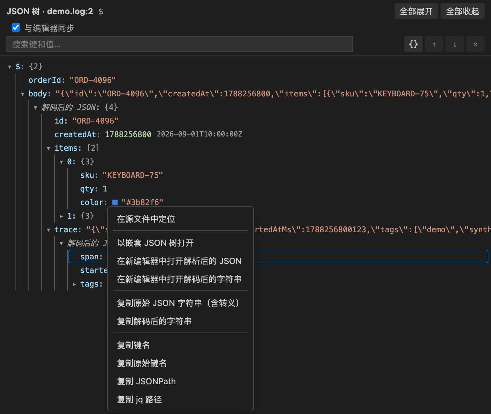
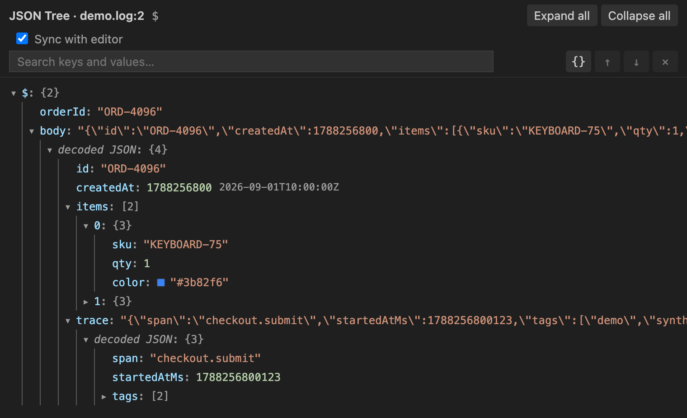

# Nested JSON Tree

<p align="center">
  
</p>

<p align="center">
  在 VS Code 中用交互式树查看 JSON、JSONL、日志中的 JSON，以及转义字符串里的嵌套 JSON。
</p>

<p align="center">
  <a href="README.md">English</a> ·
  <a href="https://github.com/stevelee477/nested-json-tree/actions/workflows/ci.yml"></a> ·
  <a href="LICENSE"></a>
</p>

Nested JSON Tree 专门处理普通格式化工具不擅长的 JSON：日志行中夹杂的 JSON、JSONL 文件里的单条记录，以及嵌套多层的转义 JSON 字符串。

<a href="assets/screenshots/tree-search.png"></a>

## 主要功能

- 将 JSON/JSONC 文档、选中内容或剪贴板打开为可折叠的树。
- 在树中**原地展开**转义的 JSON 字符串，可以一层层展开，不用另开面板。
- 树与编辑器保持同步：在源文件中定位任意节点，高亮光标处的节点，编辑后自动刷新。
- 支持 JSONC 的行注释、块注释和尾逗号。
- JSON 前后有日志或其他无关文字时，仍可提取完整 JSON；同一行的多个 JSON 会分别列出。
- 对缺逗号、截断、部分非法值的 JSON，尽力恢复可确认的字段，并明确标注恢复结果。
- 在同一个 Tree View 中浏览 JSONL/NDJSON 的有效记录，不把整个文档送入解析器。
- 右键字符串，递归打开转义或重复编码的嵌套 JSON。
- 将嵌套 JSON 反转义、解析并格式化到普通编辑器。
- 将任意字符串反转义后原样打开为纯文本，真实保留换行等解码字符，不要求内容是 JSON。
- 大整数以及 `"\u0061"`、`"\/"` 这样的原始 token 在显示、搜索、复制和格式化时都不会失真。
- 分片搜索解码值与原始字段/值，过滤无关分支并逐个跳转结果。
- 复制无损值、解码字符串、完全原样的转义字符串、JSONPath 和 jq 路径。
- 检出多个 JSON 时弹出候选列表。
- 小树自动展开，大树保持易于浏览。
- 为 Unix 时间戳、颜色值、字符串长度和链接显示提示。
- 界面支持英文和简体中文，跟随 VS Code 的显示语言。

<a href="assets/screenshots/zh-cn.png"></a>

## 嵌套 JSON

内容是 JSON 对象或数组的字符串前面会显示展开箭头。点击它（或按 `→`）即可**原地解码**：解析结果显示为一个“解码后的 JSON”子节点，多重编码会自动逐层解开，解码出的值里如果还有编码字符串，也可以继续展开。搜索会覆盖已解码的内容；**复制 jq 路径**会生成可直接运行的过滤器，例如 `.payload | fromjson | .user.id`。JSONPath 无法跨越编码字符串，因此复制的是相对于解码值的路径。

<a href="assets/screenshots/inline-decoding.png"></a>

JSON 前后带有其他文字的字符串（比如 `retrying: {"attempt": 2}`）也可以展开，节点会标注为“解码后的 JSON（从文本中提取）”；复制它下面的 jq 路径时会提示 `fromjson` 无法直接解析这种字符串。打开搜索栏的 **{}** 按钮后，会在搜索前解码所有内嵌 JSON 的字符串（每棵树最多 2,000 个）。

也可以右键字符串节点，在单独的 Tree View 中打开其中的 JSON。新打开的 Tree View 支持相同操作，因此可以继续逐层深入。

<a href="assets/screenshots/nested-json-menu.png"></a>

选择 **Open parsed JSON in new editor** 可以把字符串反转义并格式化为普通 JSON 文档；选择 **Open decoded string value in new editor** 则会把解码后的文本不经解析、格式化，直接打开为纯文本。

## JSONL / NDJSON

把光标放到目标记录上，通过编辑器右键菜单或命令面板执行 **Nested JSON Tree: Open Current Line as Tree**。

<a href="assets/screenshots/jsonl-current-line.png"></a>

Tree View 会保留源文件地址和当前行号。可以用 **Prev**、**Next** 或输入行号，在当前 Tab 中跳转到有效记录；空行、无法恢复的行和触发资源上限的行会被跳过；可部分恢复的记录会带警告显示。**Source** 用于定位源文件中的当前记录。**Follow cursor** 默认关闭，需要时可手动开启。

编辑器右键入口只在 JSON/JSONC 和 JSONL/NDJSON 文件中显示。对于文本和日志文件，仍可通过 `Cmd+Shift+P` / `Ctrl+Shift+P` 调用两个命令。开启 **Follow cursor** 后，还会高亮当前行中光标所在的节点。

## 选中内容、剪贴板与源文件同步

选中任意文本（比如日志行中的 JSON 部分，或跨多行的一段内容），在编辑器右键菜单中选择**以树形式打开选中内容**。**以树形式打开剪贴板**会解析从终端或浏览器复制的内容。

从文档或选中内容打开的树会与源文件保持关联：

- 右键菜单中的**在源文件中定位**会在编辑器中选中该节点的准确范围；对已解码的字符串内容，会定位到外层的字符串。
- **与编辑器同步**（默认开启）会高亮编辑器光标处的节点，不会抢走键盘焦点。
- 文档树会在停止输入约半秒后自动重新解析，并保留展开状态、已原地解码的字符串、搜索和滚动位置。文档暂时没有有效 JSON 时，继续显示上一个有效版本。超过 50 万字符（`nestedJsonTree.liveRefreshMaxCharacters`）的文本不会每次编辑都重新解析，而是显示**刷新**按钮。
- 由选中内容生成的树会跟随选区外的编辑，选区内被编辑后重新解析；编辑跨过选区边界时取消关联。
- JSONL 树会在上方插入或删除行时跟随所在的记录，记录本身被编辑时重新解析，所在行被删除后停止跟随。

## 不完整 JSON 与展开性能

例如日志中的 `{"id":7,"broken":undefined,"ok":true}` 会恢复出 `id` 和 `ok`；缺少结束括号或末尾字符串被截断时，也会保留前面可确认的字段。缺少逗号的字段可以尽力识别，但不会把 `01`、`1e`、非法转义等损坏 token 猜成有效值，也不会自动把单引号或无引号字段改成 JSON。

恢复的树会显示 **Recovered partial JSON**，候选列表会标注 **recovered subset**。提示中包含部分错误类型和相对候选原文的字符位置。复制或打开编辑器得到的是恢复后的子集，**不是原始完整 JSON**；数组中损坏的元素会被省略，因此恢复后的下标可能与原文不同。原文件不会被修改。

一键展开按时间和节点数分片执行，多个小对象共享同一批处理，不再逐个等待定时器。展开中可以点击 **Collapse all** 取消，也可以直接搜索来中断展开。超过 10,000 节点的树仍禁用一键完全展开，可以手动分片展开。

## 安装

### 从 GitHub Release 安装

1. 从 [Releases](https://github.com/stevelee477/nested-json-tree/releases) 下载最新 `.vsix`。
2. 在 VS Code 中打开扩展面板。
3. 选择 **… → Install from VSIX…**，然后选择下载的文件。

也可以使用命令行：

```sh
code --install-extension nested-json-tree-<version>.vsix
```

## 命令

| 命令 | 用途 |
| --- | --- |
| `Nested JSON Tree: Open Document as Tree` | 从当前文档提取 JSON 并打开 Tree View。 |
| `Nested JSON Tree: Open Current Line as Tree` | 从光标所在行提取 JSON 并打开 Tree View。 |
| `Nested JSON Tree: Open Selection as Tree` | 从选中文本提取 JSON 并打开 Tree View（有选中内容时也会出现在编辑器右键菜单中）。 |
| `Nested JSON Tree: Open Clipboard as Tree` | 从剪贴板提取 JSON 并打开 Tree View。 |

## Tree View 操作

- **Expand all / Collapse all**：一次展开或收起全部容器；**Expand all** 上限为 10,000 个节点。
- `Cmd+F` / `Ctrl+F`：聚焦搜索框。
- `Enter` / `Shift+Enter`：跳转下一个或上一个结果。
- `Esc`：清空搜索并恢复搜索前的展开状态。
- 显示搜索结果时仍可手动展开或收起分支，**Collapse all** 也可以使用。
- 右键节点（或按 `Shift+F10`）：复制值、字段名、JSONPath 或 jq 路径。
- 键盘操作：`↑`/`↓` 在行之间移动，`→`/`←` 展开/收起或移动到子节点/父节点，`Home`/`End` 跳到首行/末行，`Enter`/`Space` 切换容器或打开操作菜单。
- 切回被隐藏的 Tree View 标签页时，会恢复展开状态、搜索词和滚动位置。
- 字符串节点可以打开已解析 JSON，也可以将反转义后的内容原样打开为纯文本。
- 悬停在值上查看提示：以秒或毫秒为单位的 Unix 时间戳会显示 UTC 和本地时间（键名像时间字段时，比如 `createdAt`、`ts`，还会直接显示在行内）；字符串显示长度；`#3b82f6`、`rgb(…)` 这类颜色值显示色块；按住 `Cmd`/`Ctrl` 点击可打开 `http(s)` 链接。

jq 路径示例：

```jq
.users[0]["display-name"]
```

## 设置

| 设置项 | 默认值 | 说明 |
| --- | ---: | --- |
| `nestedJsonTree.autoExpandMaxNodes` | `200` | 节点数不超过此值时自动完全展开；设为 `0` 时禁用后代自动展开，超过 10,000 个节点的根节点仍保持折叠。 |
| `nestedJsonTree.liveRefreshMaxCharacters` | `500000` | 文档树和选区树在不超过这么多字符时，编辑后自动重新解析；更大的文本显示**刷新**按钮。`0` 表示始终手动刷新。 |
| `nestedJsonTree.maxValueNodes` | `500000` | 单个文档或树最多解析的 JSON 值节点数（10,000–5,000,000）。每百万节点约占用 250 MB Extension Host 内存。 |

## 解析边界

- 输入文件最大 100 MB。
- 安全上限：最多 1,024 层嵌套、合计 500,000 个值节点（可配置）、5,000 个提取候选和 50,000 个潜在容器片段。日志文本中未闭合的括号不计入嵌套层数。
- 支持常见日志前后缀；如果无关内容同时混有多组未闭合引号或注释，提取只能尽力而为。
- 支持 JSONC 注释和尾逗号；打开到编辑器时会输出严格 JSON。
- 保留数字和字符串 token、字段名转义、字段顺序与重复字段。
- 提取候选时忽略空对象 `{}` 和空数组 `[]`。
- 完整解析优先；结构损坏时仅尽力展示可确认的子集，不保证恢复所有字段或所有候选，不修复或覆盖原文。
- 格式化结果超过 16 Mi 字符时自动改用紧凑 JSON；复制或打开到编辑器的内容超过 50 Mi 字符时会拒绝操作。
- 超长字段名、值和界面路径最多显示 10,000 个首尾字符。搜索只覆盖 Tree View 中缩短后的字段；复制和嵌套打开仍使用 Extension Host 中的完整数据。
- Tree View 只读；需要编辑时可将解析结果打开到独立编辑器。

## 开发

```sh
npm install
npm test
npm run test:integration
npm run package
```

`npm run watch` 会在文件变化时重新构建扩展和 Webview bundle。`npm run demo` 会打开 VS Code 并用 [`examples/demo.log`](examples/demo.log) 布置好演示场景，`npm run screenshots` 会在 Chrome 中重新生成 Webview 截图。在 VS Code 中按 `F5` 启动 Extension Development Host。截图使用的虚构数据位于 [`examples/`](examples/)。

## 参与贡献

欢迎提交 Issue 和 Pull Request。详见 [CONTRIBUTING.md](CONTRIBUTING.md)。

## 许可证

[MIT](LICENSE)
